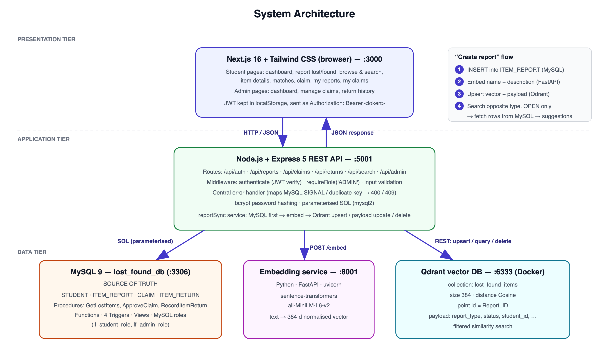

# Student Lost and Found Item Tracking System

A DBMS mini-project that helps students recover items lost on campus. Students report **lost** and **found** items, the system suggests likely matches using **semantic (vector) search**, owners **claim** found items, administrators **approve or reject** claims, and the final **return** is recorded.

| Layer | Technology |
|---|---|
| Frontend | Next.js 16 (App Router) + Tailwind CSS 4 |
| Backend | Node.js + Express 5 (REST API) |
| Relational DB | MySQL 9 — `lost_found_db` (source of truth) |
| Vector DB | Qdrant (Docker) — collection `lost_found_items`, 384-d, Cosine |
| Embeddings | `sentence-transformers/all-MiniLM-L6-v2` served by a small FastAPI service |
| Auth | bcrypt password hashing + JWT, roles `STUDENT` / `ADMIN` |



## Team

| Name | SRN | Contribution |
|---|---|---|
| Ragul Rajkumar S | PES2UG24AM128 | ER diagram, relational schema, DDL and constraints, DML, SQL queries, procedures/functions/triggers/views, MySQL roles, authentication API |
| Sharanya N | PES2UG24AM150 | Qdrant and embedding service, vector CRUD and MySQL-Qdrant sync, semantic matching/search, report and claim APIs, Next.js frontend, tests, documentation |

Course: UE23CS351A Database Management Systems, PES University.

---

## Project structure

```text
lost-found-project/
├── database/                 SQL scripts (run in order)
│   ├── 01_schema.sql         DDL: 4 tables, PK/FK/UNIQUE/NOT NULL
│   ├── 02_migrate_existing.sql  upgrade of the original DB (one-off)
│   ├── 03_routines.sql       procedures, functions, triggers
│   ├── 04_seed_base.sql      original sample data (fresh install only)
│   ├── 05_seed_demo.sql      extra demo data for semantic matching
│   ├── 06_rbac_views.sql     views + MySQL roles (DB-level RBAC)
│   └── 07_queries.sql        all demonstration queries for the report
├── embedding-service/        FastAPI app: text -> 384-d vector
├── backend/                  Express REST API
│   ├── server.js             app setup, health checks, route mounting
│   ├── db.js                 MySQL connection pool
│   ├── middleware/           JWT auth, role check, error handler
│   ├── routes/               auth, reports, claims, returns, search, admin
│   ├── services/             embedding client, Qdrant client, MySQL<->Qdrant sync
│   ├── scripts/              reindex.js, vectorDemo.js
│   └── tests/api.test.js     23 end-to-end API tests
├── frontend/                 Next.js app (student + admin UI)
├── docs/                     report, diagrams, screenshots, outputs, viva guide
└── test_qdrant.py            original Qdrant experiment
```

---

## First-time setup (fresh machine)

Prerequisites: Homebrew MySQL, Docker Desktop, Node.js 20+, Python 3.10+.

```bash
# 1. Qdrant (vector DB) in Docker, with persistent storage
docker run -d --name qdrant -p 6333:6333 -p 6334:6334 \
  -v qdrant_storage:/qdrant/storage qdrant/qdrant
curl -X PUT localhost:6333/collections/lost_found_items \
  -H 'Content-Type: application/json' \
  -d '{"vectors":{"size":384,"distance":"Cosine"}}'

# 2. MySQL schema, routines and data
mysql -u root -p < database/01_schema.sql
mysql -u root -p lost_found_db < database/03_routines.sql
mysql -u root -p lost_found_db < database/04_seed_base.sql
mysql -u root -p lost_found_db < database/05_seed_demo.sql
mysql -u root -p lost_found_db < database/06_rbac_views.sql

# 3. Python embedding service
python3 -m venv venv
./venv/bin/pip install -r embedding-service/requirements.txt

# 4. Backend
cd backend && npm install
cp .env.example .env        # then edit DB_PASSWORD and JWT_SECRET
cd ..

# 5. Frontend
cd frontend && npm install && cp .env.example .env.local && cd ..
```

## Running the system (4 terminal windows)

| Window | Command | Expected |
|---|---|---|
| 1 — Qdrant | `open -a Docker` then `docker start qdrant` | `qdrant` |
| 2 — Embeddings | `./venv/bin/uvicorn app:app --app-dir embedding-service --port 8001` | `Uvicorn running on http://127.0.0.1:8001` |
| 3 — Backend | `cd backend && npm run dev` | `Backend running at http://localhost:5001` |
| 4 — Frontend | `cd frontend && npm run dev` | `Local: http://localhost:3000` |

Health check: `curl localhost:5001/api/health` → `{"success":true,"services":{"mysql":"up","qdrant":"up","embedding":"up"}}`

After loading new SQL data, rebuild the vector index once: `cd backend && npm run reindex`.

> **macOS note:** port 5000 is used by AirPlay Receiver, so the backend runs on **5001**.

### Demo accounts

| Role | Email | Password |
|---|---|---|
| Student | arun@gmail.com, priya@gmail.com, rahul@gmail.com, sneha@gmail.com | `Student@123` |
| Admin | admin@college.edu | `Admin@123` |
| MySQL role demo | `lf_student_demo` / `lf_admin_demo` | see `database/06_rbac_views.sql` |

---

## REST API

All routes except `/api/auth/register`, `/api/auth/login`, `/api/health` and `/api/stats/public` need `Authorization: Bearer <JWT>`.

| Method | Route | Who | Purpose |
|---|---|---|---|
| POST | `/api/auth/register` | public | Create STUDENT account (bcrypt hash) |
| POST | `/api/auth/login` | public | Returns JWT |
| GET | `/api/auth/me` | logged in | Profile + report count (stored function) |
| GET | `/api/reports?type=&status=&q=&location=` | logged in | List / keyword search |
| GET | `/api/reports/mine` | logged in | Own reports with claim counts |
| GET | `/api/reports/:id` | logged in | Details (+ claims for owner/admin) |
| GET | `/api/reports/:id/matches` | logged in | Semantic matches of opposite type |
| POST | `/api/reports` | logged in | Create LOST/FOUND → MySQL + Qdrant + matches |
| PUT | `/api/reports/:id` | owner / admin | Update → re-embed or payload update |
| DELETE | `/api/reports/:id` | owner / admin | Delete from MySQL and Qdrant |
| POST | `/api/claims` | logged in | Submit claim (rules enforced by trigger) |
| GET | `/api/claims/mine` | logged in | Own claims |
| DELETE | `/api/claims/:id` | claimant | Withdraw a pending claim |
| GET | `/api/claims?status=` | ADMIN | All claims |
| PATCH | `/api/claims/:id/approve` | ADMIN | `CALL ApproveClaim` → MATCHED |
| PATCH | `/api/claims/:id/reject` | ADMIN | Reject with reason |
| POST | `/api/returns` | ADMIN | `CALL RecordItemReturn` → CLOSED |
| GET | `/api/returns` · `/api/returns/mine` | ADMIN · logged in | Return history |
| GET | `/api/search/keyword?q=` | logged in | SQL `LIKE` search |
| GET | `/api/search/semantic?q=&type=` | logged in | Qdrant similarity search |
| GET | `/api/admin/stats` · `/students` · `/vector-status` · `/vector/:id` | ADMIN | Dashboard data, vector READ |
| POST | `/api/admin/reindex` | ADMIN | Rebuild Qdrant from MySQL |

---

## Testing

```bash
cd backend
npm test             # 23 end-to-end API tests (needs MySQL, Qdrant, embeddings running)
npm run vector-demo  # Qdrant create / read / update / search / delete + matching demo
mysql -t -v lost_found_db < ../database/07_queries.sql   # all SQL demonstrations
```

Saved outputs: `docs/test_results.txt`, `docs/vector_demo_output.txt`, `docs/sql_outputs.txt`.

## Security

- Passwords are stored only as bcrypt hashes (cost 10); plaintext is never stored or logged.
- JWT signed with `JWT_SECRET` from `.env`; `.env` is git-ignored.
- Every SQL statement uses `?` placeholders (parameterised) — no string-built user input.
- Every input is validated on the server; the UI checks are only for convenience.
- Role checks happen on the server (`requireRole('ADMIN')`), in MySQL triggers (business rules) and in MySQL roles (`lf_student_role`, `lf_admin_role`).
- An admin cannot approve, reject or record a return for their own claim.
